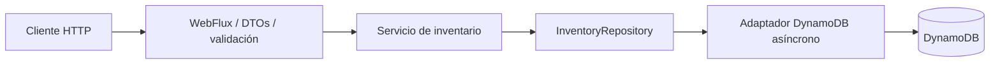

# Franquicias API

API de inventario para franquicias, sucursales y productos. Implementada con **Java 21, Spring Boot 4.1.1, WebFlux y DynamoDB**, con control de concurrencia, pruebas contra persistencia real y un contrato OpenAPI navegable sin servicios externos.

## Ejecutar en dos pasos

Con Docker Engine/Desktop y Docker Compose v2:

```bash
docker compose up --build -d
docker compose logs -f api
```

Cuando la API esté lista:

- **Swagger UI:** <http://localhost:8080/docs.html>
- **Contrato OpenAPI:** <http://localhost:8080/openapi.json>
- **Readiness:** <http://localhost:8080/actuator/health/readiness>

Compose inicia DynamoDB, crea la tabla de forma idempotente y después arranca la API. El volumen `dynamodb-data` conserva los datos. `docker compose down` detiene los servicios; `docker compose down -v` también elimina los datos. Los puertos publicados se limitan a localhost.

### Windows sin Docker

Requisitos: **JDK 21+**, `java` en PATH y **PowerShell 7**. Maven Wrapper descarga Maven; no necesitas instalar Maven ni AWS CLI. La primera ejecución requiere internet para descargar dependencias y DynamoDB Local desde AWS.

```powershell
./scripts/start-local.ps1
./scripts/smoke.ps1
```

El arranque compila y ejecuta las pruebas unitarias, prepara la tabla y deja la API y DynamoDB en segundo plano. Los logs están en `.local/`; los datos, en `.local/data/`. Si ya compilaste, puedes usar `./scripts/start-local.ps1 -SkipBuild`. Para detener ambos procesos conservando los datos:

```powershell
./scripts/stop-local.ps1
```

### Java con DynamoDB de Compose

Puedes ejecutar la API desde el IDE usando el perfil `local`:

```bash
docker compose up -d dynamodb init-db
./mvnw spring-boot:run -Dspring-boot.run.profiles=local
```

En Windows usa `./mvnw.cmd` y pon argumentos `-D...` entre comillas en PowerShell. `JAVA_HOME` debe apuntar a un JDK compatible, además de tener `java` en PATH.

## Cobertura del enunciado

| Requisito | Entrega |
| --- | --- |
| Spring Boot | 4.1.1 con Java 21 |
| Crear franquicia | `POST /api/v1/franchises` |
| Crear sucursal | `POST /api/v1/franchises/{franchise}/branches` |
| Crear producto | `POST /api/v1/franchises/{franchise}/branches/{branch}/products` |
| Eliminar producto | `DELETE /api/v1/franchises/{franchise}/branches/{branch}/products/{product}` |
| Cambiar stock | `PATCH .../products/{product}/stock` |
| Mayor stock por sucursal | `GET /api/v1/franchises/{franchise}/products/max-stock` |
| Persistencia | DynamoDB Local; Terraform preparado para DynamoDB en AWS |
| Docker | Dockerfile multietapa, usuario de aplicación sin privilegios y Compose |
| Programación reactiva y funcional | Reactor, WebFlux, SDK asíncrono, records inmutables y reducción funcional |
| Cambiar los tres nombres | `PATCH .../{franchise}/name`, `.../branches/{branch}/name`, `.../products/{product}/name` |
| Infraestructura como código | Terraform: DynamoDB, ECR, IAM y App Runner |
| Despliegue completo en nube | Preparado y documentado; **no ejecutado**, por alcance local |
| Repositorio público | Historia Git local; **publicación pendiente** |

También hay GET individuales y listados de sucursales y productos para obtener los UUID y versiones actuales. Todos los endpoints y modelos se describen en [OpenAPI](src/main/resources/static/openapi.json).

## Probar el flujo

En Swagger UI ejecuta estas operaciones, copiando los UUID retornados:

1. Crear franquicia: `{"name":"Café Andino"}`.
2. Crear sucursal: `{"name":"Chapinero"}`.
3. Crear producto: `{"name":"Café de origen","stock":15}`.
4. Cambiar stock: `{"stock":80,"version":0}`.
5. Consultar `.../products/max-stock`.
6. Cambiar nombre del producto: `{"name":"Café especial","version":1}`.
7. Eliminarlo con DELETE; retorna `204` sin cuerpo.

Los POST retornan `201`, el recurso creado y su cabecera `Location`. La versión inicial es `0`. Cada PATCH exitoso incrementa la versión, incluso si el nuevo valor coincide con el anterior.

Ejemplo del resultado de mayor stock:

```json
[
  {
    "branchId": "e2f6249b-e207-4b61-80e3-eaf740ab5ee7",
    "branchName": "Chapinero",
    "productId": "1769dafa-a2b8-439e-acd1-675ecbb32b98",
    "productName": "Café de origen",
    "stock": 80,
    "version": 1
  }
]
```

Puedes usar [docs/demo.http](docs/demo.http) o `./scripts/smoke.ps1`; el script ejercita todos los cambios del enunciado y conserva una franquicia y sucursal de demostración sin productos.

### Reglas explícitas

- Nombres obligatorios, no vacíos, máximo 120 caracteres; se eliminan espacios externos. Los nombres repetidos se permiten: los UUID identifican los recursos.
- Stock entero entre `0` y `2147483647`; se reemplaza el valor absoluto. No se aceptan valores negativos, decimales o ausentes.
- Todo PATCH exige `version`, un entero no negativo obtenido al consultar el recurso. Un escritor con versión obsoleta recibe `409`; debe leer y reconciliar antes de reintentar.
- El padre debe existir. Crear una sucursal o producto comprueba e inserta dentro de una transacción DynamoDB.
- El UUID de producto se resuelve dentro de su franquicia y sucursal. Usarlo con otra jerarquía retorna `404`.
- Una sucursal sin productos se omite del máximo. Una franquicia existente sin productos retorna `[]`; una inexistente retorna `404`.
- En empate se elige el UUID de producto lexicográficamente menor. El resultado se ordena por UUID de sucursal.
- Eliminar un producto existente retorna `204`; repetir la eliminación retorna `404`.
- Errores con `application/problem+json` (Problem Details): `400` para validación, `404` para inexistentes, `409` para versión obsoleta y `503` para fallo de persistencia. No se expone el detalle interno de AWS.

## Arquitectura y decisiones



Las capas `api`, `application`, `domain` e `infrastructure` separan el contrato HTTP, la lógica, el puerto de persistencia y AWS. No hay `.block()`, `.join()` ni JDBC en el flujo de producción. Los futuros del cliente asíncrono se convierten en publishers diferidos. Los tests pueden esperar de forma bloqueante fuera del servidor.

Una tabla con claves compuestas evita cargar y sobrescribir un documento completo por cada mutación:

| Entidad | Partition key `pk` | Sort key `sk` |
| --- | --- | --- |
| Franquicia | `FRANCHISE#<franchiseId>` | `META` |
| Sucursal | `FRANCHISE#<franchiseId>` | `BRANCH#<branchId>` |
| Producto | `FRANCHISE#<franchiseId>` | `BRANCH#<branchId>#PRODUCT#<productId>` |

Cada producto se actualiza atómicamente con una condición sobre su versión. Cambiar stock y cambiar nombre comparten esa versión; no hay actualizaciones perdidas. La consulta de máximos usa `Query`, no `Scan`, recorre todas las páginas y reduce el inventario en memoria sin hacer una consulta por sucursal.

**Límites deliberados:** el máximo cuesta O(n) en tiempo y memoria sobre el inventario de una franquicia; los listados actuales también recogen el conjunto en memoria. Una franquicia muy grande necesitaría paginación HTTP, particiones adicionales y un índice/materialización del máximo. Las lecturas son fuertemente consistentes por página, pero varias páginas no constituyen un snapshot transaccional; mutaciones durante la consulta pueden cambiar el conjunto observado. No se implementan borrados de franquicias/sucursales, idempotency keys ni autenticación porque no se solicitan. La ejecución local está limitada a localhost; antes de exponer inventario real se debe añadir autorización y protección de tráfico.

## Pruebas y CI

```bash
./mvnw verify
./mvnw verify -Pintegration
```

El primer comando ejecuta pruebas unitarias y genera el JAR. El segundo añade pruebas completas HTTP con DynamoDB Local mediante Testcontainers; requiere Docker y **no omite silenciosamente** la suite si Docker falta.

Si DynamoDB Local ya está escuchando en el puerto 8000 (por el script o por Compose):

```powershell
./mvnw.cmd verify -Pintegration "-Ddynamodb.test.endpoint=http://localhost:8000"
```

Las pruebas crean una tabla con nombre aleatorio y la eliminan al terminar, sin tocar la tabla `franchises`. Incluyen el ciclo completo, validación, jerarquías incorrectas, padres ausentes, cero stock, conflicto de versión, dos escritores concurrentes y consulta de más de 1 MB. JaCoCo produce `target/site/jacoco/index.html`; Surefire/Failsafe guardan reportes en `target/`.

[GitHub Actions](.github/workflows/ci.yml) ejecuta unitarias e integración, construye Docker y valida Terraform. La verificación local efectivamente realizada se registra en [docs/verification.md](docs/verification.md).

## Configuración

| Variable | Valor por defecto | Uso |
| --- | --- | --- |
| `PORT` | `8080` | Puerto HTTP |
| `AWS_REGION` | `us-east-1` | Región DynamoDB |
| `DYNAMODB_TABLE` | `franchises` | Nombre de tabla |
| `DYNAMODB_ENDPOINT` | vacío en producción, `http://localhost:8000` en perfil local | Endpoint local opcional |
| `SPRING_PROFILES_ACTIVE` | sin perfil | `local` para DynamoDB Local |

En AWS no se configura `DYNAMODB_ENDPOINT`; el SDK utiliza credenciales del rol de ejecución mediante su cadena predeterminada. Solo el endpoint local usa credenciales ficticias. No hay secretos en el repositorio. Liveness comprueba el proceso; readiness además comprueba acceso a la tabla. El cliente tiene timeout de intento de 4 s y total de 10 s; el servidor realiza apagado ordenado.

## Desplegar en AWS y publicar

[infra/README.md](infra/README.md) explica el despliegue de persistencia y aplicación, roles, costes y eliminación. Terraform está preparado para ejecutarse bajo tu cuenta, pero la entrega actual es local y no constituye una evidencia de despliegue real en nube.

Para cumplir la nota de repositorio público al presentar la prueba, autentícate y publica el historial existente (requiere GitHub CLI):

```bash
gh auth login
gh repo create franchises-api --public --source=. --remote=origin --push
```

Sustituye el nombre si ya existe. Entrega al evaluador la URL pública, enlaza este README y verifica el resultado de CI. No se creó una cuenta, repositorio remoto ni recurso en nube durante esta entrega local.
